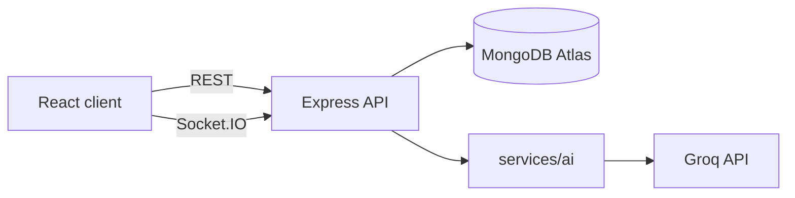

# BookLeaf Author Support & Communication Portal

A web app where authors raise and track support tickets, and BookLeaf's operations team triages them faster with AI-assisted classification, priority scoring and draft replies grounded in the BookLeaf knowledge base.

| | |
|---|---|
| **Live app** | [FRONTEND_URL] |
| **API** | [BACKEND_URL]/api/v1 |
| **API docs (Swagger)** | [BACKEND_URL]/api/docs |

> The backend runs on a free tier and sleeps when idle, so the first request can take ~30 seconds. Open the health endpoint (`/api/v1/health`) once before testing.

## Test credentials

| Role | Email | Password | Good for testing |
|---|---|---|---|
| Admin | admin@bookleaf.com | Admin@123 | Full admin portal |
| Admin | ops@bookleaf.com | Admin@123 | Second admin (assignment, live updates) |
| Author | priya.sharma@email.com | Author@123 | Normal case: 2 published books, some pending royalty |
| Author | ananya.reddy@email.com | Author@123 | Royalty pending, no payout yet |
| Author | sneha.kulkarni@email.com | Author@123 | Has a book in production, plus high sales |
| Author | kavita.deshmukh@email.com | Author@123 | Book in typesetting, pending royalty below the ₹1,000 threshold |

All 10 authors in the provided dataset can log in with their dataset email and the password `Author@123`.

---

## Contents
1. [Features](#features)
2. [Tech stack](#tech-stack)
3. [Project structure](#project-structure)
4. [Run locally](#run-locally)
5. [Deployment](#deployment)
6. [Architecture and decisions](#architecture-and-decisions)
7. [AI integration](#ai-integration)
8. [API reference](#api-reference)
9. [Security](#security)
10. [Testing](#testing)
11. [Edge cases handled](#edge-cases-handled)
12. [Known limitations and future work](#known-limitations-and-future-work)
13. [Assumptions](#assumptions)

---

## Features

### Author portal
- **Login**: email and password. Each author sees only their own data.
- **My Books**: title, ISBN, genre, publication date, status, MRP, copies sold, royalty earned / paid / pending. Books still in production show a production stage tracker instead of royalty figures.
- **Submit a Support Query**: choose a book or "General / Account Level", add a subject and a description (with character counters), and optionally pick attachments (UI only).
- **My Tickets**: all submitted tickets with status (Open, In Progress, Resolved, Closed), the original query and the admin replies. Updates arrive live without a page refresh. Authors can send follow-up messages.

### Admin portal
- **Ticket queue**: all tickets across authors, filterable by status, category, priority, assignee, date and search. Sorted by urgency, then oldest first. Overdue tickets are flagged.
- **AI auto-classification** into six categories: Royalty & Payments, ISBN & Metadata Issues, Printing & Quality, Distribution & Availability, Book Status & Production Updates, General Inquiry. Admins can override it.
- **AI priority score** (Critical / High / Medium / Low) with a short reason. Admins can override it.
- **AI-drafted reply** based on the ticket, the author's real book data and the BookLeaf knowledge base. Editable before sending, never auto-sent.
- **Ticket management**: update status, assign to self, add internal notes (never visible to authors).
- **Dashboard stats** for open, in progress, critical, overdue and unassigned tickets.

### Cross-cutting
- Real-time updates through Socket.IO (with a polling fallback).
- Role-based access control on every route.
- Loading, empty and error states on every page.
- A hand-drawn visual theme (see `client/DESIGN.md`).

---

## Tech stack

| Layer | Choice |
|---|---|
| Frontend | React (Vite), React Router, Axios, socket.io-client, Tailwind CSS, lucide-react |
| Backend | Node.js, Express |
| Database | MongoDB Atlas with Mongoose |
| Auth | JWT + bcrypt, `role` field (`author` / `admin`) |
| Validation | Zod |
| Real time | Socket.IO |
| AI | Groq API (`groq-sdk`) with Llama models |
| API docs | Swagger UI (`swagger-ui-express`) with a hand-written OpenAPI file |
| Deployment | Vercel (frontend), Render (backend), MongoDB Atlas |

Frontend UI dependencies are limited to Tailwind CSS, lucide-react and two Google Fonts (Kalam, Patrick Hand).

---

## Project structure

```
bookleaf-portal/
├── README.md
├── WRITEUP.md
├── server/
│   ├── openapi.yaml
│   ├── .env.example
│   ├── data/bookleaf_sample_data.json
│   └── src/
│       ├── app.js, server.js        # Express app / HTTP + Socket.IO bootstrap
│       ├── config/                  # env validation (Zod), DB connection
│       ├── models/                  # User, Author, Book, Ticket
│       ├── routes/                  # auth, books, tickets, admin, health
│       ├── controllers/             # thin request handlers
│       ├── services/                # business logic
│       │   └── ai/                  # groqClient, classifier, drafter, prompts,
│       │                            # knowledgeBase, fallbackClassifier
│       ├── middleware/              # authenticate, requireRole, validate, errorHandler
│       ├── validators/              # Zod schemas
│       ├── sockets/                 # authenticated Socket.IO events
│       ├── utils/                   # ApiError, asyncHandler, logger
│       └── seed/seed.js             # idempotent seeding
└── client/
    ├── DESIGN.md                    # design tokens and component rules
    └── src/
        ├── api/                     # Axios instance and API calls
        ├── context/                 # AuthContext
        ├── socket/                  # Socket.IO client
        ├── components/ (ui/)        # shared UI components
        ├── pages/                   # Login, author pages, admin pages
        ├── theme/                   # wobbly radius constants
        └── utils/
```

---

## Run locally

**Prerequisites:** Node.js 18+, a MongoDB Atlas cluster (or local MongoDB), and a free Groq API key from console.groq.com.

### 1. Server
```bash
cd server
cp .env.example .env      # then fill in the values below
npm install
npm run seed              # loads 10 authors, 18 books, users, sample tickets
npm run dev               # http://localhost:5000
```

| Variable | Description |
|---|---|
| `PORT` | Server port (default 5000) |
| `MONGODB_URI` | MongoDB Atlas connection string |
| `JWT_SECRET` | Long random string for signing tokens |
| `JWT_EXPIRES_IN` | Token lifetime, e.g. `1d` |
| `CLIENT_ORIGIN` | Frontend URL, used for CORS and Socket.IO (e.g. `http://localhost:5173`) |
| `GROQ_API_KEY` | Groq API key (server only) |
| `GROQ_CLASSIFY_MODEL` | e.g. `llama-3.1-8b-instant` |
| `GROQ_DRAFT_MODEL` | e.g. `llama-3.3-70b-versatile` |
| `AI_TIMEOUT_MS` | Per-call AI timeout (default 15000) |

The app validates these at startup and fails with a clear message if one is missing. `GROQ_API_KEY` is optional: without it the app still works, with rule-based classification and manual replies.

### 2. Client
```bash
cd client
cp .env.example .env
npm install
npm run dev               # http://localhost:5173
```

| Variable | Description |
|---|---|
| `VITE_API_URL` | Backend API base, e.g. `http://localhost:5000/api/v1` |
| `VITE_SOCKET_URL` | Backend origin for Socket.IO, e.g. `http://localhost:5000` |

### Useful scripts
| Command | What it does |
|---|---|
| `npm run seed` (server) | Idempotent seeding from the provided JSON |
| `npm run eval:ai` (server) | Runs sample queries through the AI and prints category, priority and draft |
| `npm test` (server) | Runs the test suite |
| `npm run build` (client) | Production build |

---

## Deployment

1. **MongoDB Atlas:** create a cluster, a database user, and allow network access (0.0.0.0/0 for the demo). Copy the connection string.
2. **Render (backend):** new Web Service, root directory `server`, build `npm install`, start `npm start`, health check path `/api/v1/health`. Add all server env vars. Set `CLIENT_ORIGIN` to the Vercel URL. Run `npm run seed` once (Render shell, or locally against the Atlas URI).
3. **Vercel (frontend):** root directory `client`, framework Vite. Set `VITE_API_URL` and `VITE_SOCKET_URL` to the Render URL. `vercel.json` contains the SPA rewrite.
4. Free-tier note: Render sleeps when idle, so open the health URL a minute before a demo.

---

## Architecture and decisions



**Layered backend (routes → controllers → services → models).** Controllers only parse the request and shape the response. Business rules live in services, so they can be tested without HTTP. All AI code sits behind `services/ai`, so the provider can be swapped without touching the rest of the app.

**MongoDB with embedded replies and notes.** Replies and internal notes are always read together with their ticket and are small, so embedding them gives one read per ticket and atomic updates. Authors, books and tickets are separate collections, with indexes on `(author, createdAt)`, `(status, priority, createdAt)` and `category` to keep the queue and author views fast.

**JWT with a role claim.** Stateless auth works well across Vercel and Render. The token holds `sub`, `role` and `authorId`. For author routes, the server always filters by the `authorId` from the token and never trusts IDs sent by the client, which is what enforces "authors see only their own data". Admin routes sit behind `requireRole('admin')`.

**Zod everywhere.** Env vars, request bodies, params, queries and the AI's JSON output are all validated with Zod. A central error handler turns validation and application errors into a consistent `{ error: { code, message, details? } }` response with proper status codes (400, 401, 403, 404, 409, 429, 503) instead of generic 500s.

**AI runs asynchronously.** `POST /tickets` saves the ticket and returns immediately. Classification runs afterwards and the result is pushed to admins over the socket. A slow or failing AI can never block an author.

**Computed facts live in code, not in the model.** Next payout date, the ₹1,000 rollover rule, and "never paid" or "in production" states are computed deterministically in `royalty.js`, then handed to the model as facts. This avoids invented numbers.

**Socket.IO with a polling fallback.** The handshake is authenticated with the JWT. Authors join only their own room, and admins join an `admins` room. Author payloads exclude internal notes and AI fields. If the socket cannot connect, the tickets page falls back to polling every 15 seconds.

**Admin queue ordering.** Unresolved tickets sort by priority weight, then by age. Ticket age against priority-based thresholds sets an `isOverdue` flag, so the most urgent and oldest tickets are easy to spot.

---

## AI integration

### Model choice
Groq with Llama models. It is free (the brief allows any provider), low-latency, and supports JSON output. Two models are used for different jobs:

| Job | Model | Why |
|---|---|---|
| Classification and priority | `llama-3.1-8b-instant` | Small, fast and cheap for a structured task |
| Draft replies | `llama-3.3-70b-versatile` | Better writing and tone consistency |

Model names are environment variables, so they can change without code changes. Trade-off: free-tier rate limits and slightly weaker prose than top paid models, which is mitigated by the fallback behaviour below.

### Classification and priority
- One call returns `{ category, priority, reason }` in JSON mode with `temperature: 0`.
- The input is only the ticket subject and description (truncated), the book's status line and a short rubric. The knowledge base and ticket history are **not** sent here.
- Output is validated with Zod. If invalid, it retries once and then falls back to rules.
- Priority rubric examples: months without any royalty, or any ISBN mismatch, is Critical or High (ISBN errors are always at least High per the knowledge base); delayed royalty, print defects and unavailable listings are High; status questions and royalty calculations are Medium; bio or description updates are Low.
- Both the AI's values and the final values are stored, plus who overrode them, so accuracy can be measured later.

### Draft replies
The knowledge base is split into sections (royalty, ISBN, printing, distribution, production stages, tone) and sample query-response examples. For each draft, the context is assembled like this:

| Part | Included |
|---|---|
| System prompt | Persona and tone rules (always, short) |
| Knowledge base | **Only the section for the ticket's category**, plus one matching example |
| Author and book facts | Computed in code: title, status, MRP, copies sold, royalty earned / paid / pending, last payout date, platforms, print partner, next payout date, threshold rollover |
| Ticket | Subject, description, and only the last 3 thread messages |
| Limits | `max_tokens` about 450, `temperature` 0.3 |

### Prompt strategy
- Write as a BookLeaf support representative, not "an AI". Sign off as Team BookLeaf Support.
- Acknowledge the concern first, then use the real numbers provided. Own BookLeaf's mistakes directly with no corporate deflection, and never blame the author for delays.
- Give a clear timeline for escalations ("within 48 hours") and always end with a next step.
- Never invent policies, dates or figures. If information is missing, say what the team will verify.
- The author's message is wrapped in tags and treated as untrusted data; the prompt tells the model to ignore any instructions inside it (prompt-injection guard).
- Edge-case guidance is built into the facts: a pending royalty below ₹1,000 gets a rollover explanation instead of "overdue"; a null payout date with pending royalty prompts bank-details check plus escalation; books in production get an honest production-stage answer and no invented sales.

### Cost management
- Cheap small model for classification with a short prompt and about 150 output tokens.
- Category-specific knowledge base section instead of the whole knowledge base (a fraction of the tokens).
- Thread history capped at 3 messages; long text truncated.
- Drafts are cached on the ticket and regenerated only on an explicit request or after a new author message.
- The draft endpoint is rate-limited per admin. Token usage per call is logged.

Approximate tokens per call (replace with your measured values from the logs):
| Call | Input | Output |
|---|---|---|
| Classification | ~[300] | ~[60] |
| Draft | ~[900] | ~[300] |

### Error handling and graceful degradation
- The Groq wrapper applies a timeout, up to 2 retries with exponential backoff on 429/5xx/timeouts (honouring `retry-after`), and maps failures to a typed `AIUnavailableError`.
- A circuit breaker pauses AI calls for a short period after repeated failures to avoid hammering a rate-limited API.
- If classification fails, **the ticket is still created**. A keyword-rule classifier assigns a category and priority, the ticket is marked `aiStatus: failed`, and the admin UI shows a "classified by rules, please review" tag. The admin can retry through `POST /admin/tickets/:id/reclassify`.
- If drafting fails, the endpoint returns `503 AI_UNAVAILABLE`, and the UI shows "AI is resting, write your reply manually" with the reply box fully usable.
- With no `GROQ_API_KEY` set, the app runs normally in fallback mode.

### Evaluation
`npm run eval:ai` runs the seven sample queries from the brief plus extra cases and prints the category, priority and draft for review.
Results: [add yours, e.g. "6 of 7 classified as expected; the miss was ...; fixed by ..."].

---

## API reference

Base path `/api/v1`. All routes except login and health require an `Authorization: Bearer <JWT>` header. Full request and response schemas with examples are in Swagger at `/api/docs` (source: `server/openapi.yaml`).

### Auth and system
| Method | Path | Role | Description |
|---|---|---|---|
| POST | `/auth/login` | public | Email + password, returns `{ token, user }` |
| GET | `/auth/me` | any | Current user |
| GET | `/health` | public | DB and AI configuration status (no secrets) |

### Author
| Method | Path | Description |
|---|---|---|
| GET | `/books` | The author's own books |
| GET | `/books/:id` | One book (404 if not the author's) |
| POST | `/tickets` | Create a ticket `{ bookId \| null, subject, description, attachments? }` |
| GET | `/tickets` | The author's tickets (no internal notes or AI fields) |
| GET | `/tickets/:id` | One ticket with replies |
| POST | `/tickets/:id/replies` | Author follow-up (reopens a Resolved ticket) |

### Admin
| Method | Path | Description |
|---|---|---|
| GET | `/admin/tickets` | Queue. Query: `status, category, priority, assignedTo, dateFrom, dateTo, search, page, limit` |
| GET | `/admin/tickets/:id` | Full ticket with author, book, notes and AI data |
| PATCH | `/admin/tickets/:id` | Update status, category or priority (override), assignee |
| POST | `/admin/tickets/:id/assign-me` | Assign to the calling admin |
| POST | `/admin/tickets/:id/notes` | Add an internal note |
| POST | `/admin/tickets/:id/draft` | Generate or regenerate the AI draft |
| POST | `/admin/tickets/:id/reply` | Send the (edited) reply, optionally set status |
| POST | `/admin/tickets/:id/reclassify` | Retry AI classification |
| GET | `/admin/stats` | Counts by status, category, priority, plus overdue |

### Error format
```json
{ "error": { "code": "VALIDATION_ERROR", "message": "Subject must be at least 3 characters", "details": [] } }
```

### Socket.IO events
Authenticated with `auth.token`. Server emits `ticket:created` (admins), `ticket:updated` (the ticket's author and admins), `ticket:reply` (the author), and `ticket:ai-ready` (admins).

---

## Security
- API keys and secrets live only in environment variables. The Groq key never reaches the frontend bundle, and `.env` is git-ignored (only `.env.example` is committed).
- Passwords are hashed with bcrypt. Login returns one generic error for wrong email or wrong password.
- Authentication middleware on all protected routes, role checks for admin routes, and ownership checks based on the token for author data.
- Internal notes and AI fields are stripped from every author response and socket payload.
- Helmet, CORS restricted to the frontend origin, and rate limits (stricter on login).
- Input validated with Zod; AI input is length-limited, and ticket text is treated as untrusted.

---

## Testing
- Server tests (Jest + Supertest) cover: login and role guards, an author being unable to read another author's tickets, author payloads excluding internal notes and AI fields, and ticket creation still succeeding when the AI fails or no key is set.
- `npm run eval:ai` checks AI classification and draft quality on sample queries.
- [Describe any manual QA you did.]

---

## Edge cases handled
- Books in production (null publication date, MRP and royalty fields): shown with a production stage tracker and no invented figures; the AI draft explains the stage honestly.
- Authors with zero payouts or a null last-payout date: "No payout yet", with escalation logic in drafts.
- Pending royalty below ₹1,000: treated as a rollover, not an overdue payment.
- Empty states: no books, no tickets, an empty admin queue.
- AI down, rate limited or unconfigured: tickets still created, rule-based classification, manual replies.
- Socket disconnects: reconnect, then polling fallback.
- Invalid or expired token: 401 and automatic logout on the client.

---

## Known limitations and future work
- **Attachments are UI only.** Real uploads would need object storage (S3) and virus scanning.
- **JWT in localStorage** is exposed to XSS. Production should use httpOnly cookies with refresh tokens.
- **AI jobs run in-process.** A queue (BullMQ + Redis) would add durability, retries and rate-limit smoothing.
- **Socket.IO is single-instance.** Scaling out needs the Redis adapter.
- **Static knowledge base.** Embedding-based retrieval would scale better to a larger KB, and sent-reply edits could feed back into prompts.
- **Not built:** email notifications, SLA timers and escalation alerts, an audit log of overrides, a detailed per-platform royalty breakdown, observability dashboards (token cost, latency), and broader automated test coverage.
- **Free-tier constraints:** Groq rate limits and Render cold starts.
- **Admin accounts** are seeded; there is no admin management screen.

---

## Assumptions
- Authors are pre-seeded from the dataset; there is no public signup.
- The dataset has no passwords, so a default author password is set at seed time for demo purposes.
- "Overdue" thresholds by priority (e.g. Critical > 24h) are my own choice, as the brief does not define SLAs.
- The next payout date is computed as the end of the current quarter plus 45 days, based on the knowledge base policy.
- [Add any other assumption you made.]
